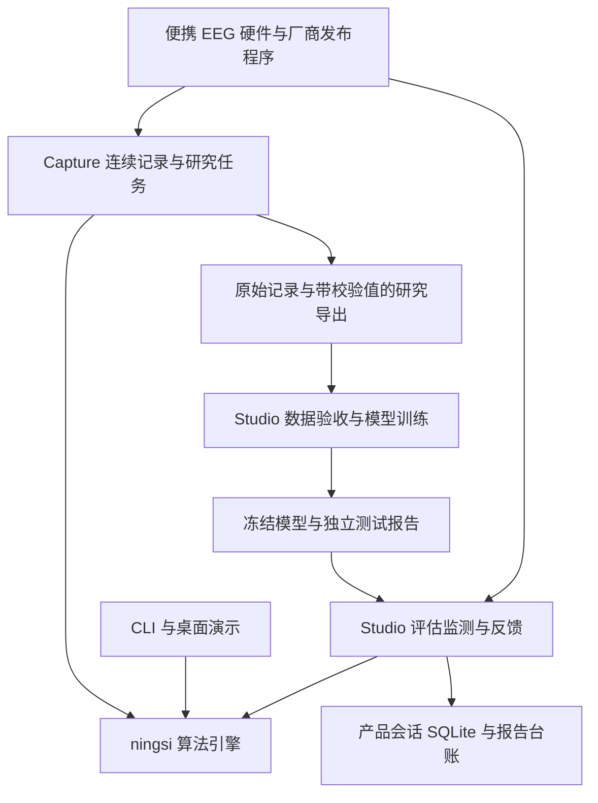
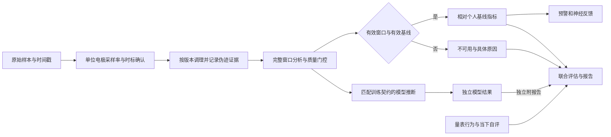
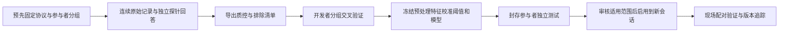

# 凝思系统架构

更新日期：2026 年 11 月 17 日。本文面向项目开发与比赛方案维护，说明当前源码的模块职责、数据流和扩展边界。源码版本以各包的 `pyproject.toml` 为准：引擎 0.1.2、Studio 0.1.12、Capture 0.4.1；已有发行包仍以包内构建记录为准。

凝思按 A09 的六段技术范式组织：**硬件采集、信号预处理、特征提取、模型识别、评估输出、反馈干预**。三套程序共用算法引擎，采集记录、产品会话和研究模型分别管理，通过有版本和校验值的文件衔接。

## 模块职责与依赖

图中同时包含代码依赖与数据传递；Capture 和 Studio 之间通过导出文件传递数据，不互相导入 Python 包。

| 位置 | 职责 | 边界 |
|---|---|---|
| `ningsi/src/ningsi/acquisition/` | EEG 类型、单位、时标策略、LSL 与仿真接入 | 明确原始值、物理单位和时间依据 |
| `ningsi/src/ningsi/signal/` | 调理、PSD、频带、质量判定、基线和相对指标 | 不依赖产品服务或界面；冻结模型兼容例外见下文 |
| `ningsi/src/ningsi/processing/` | 已调理窗口的特征分析、质量证据合并与指标计算 | 无采集、文件、数据库或界面 I/O；CLI 与 Studio 共用 |
| `ningsi/src/ningsi/models/` | 特征契约、模型训练、数据验收、冻结权重与推断 | 校验标签方向、设备配置和实现指纹 |
| `ningsi/src/ningsi/behavior/`、`scales/` | 行为任务与心理量表的独立计分 | 不用脑电预测生成真值标签 |
| `ningsi/src/ningsi/assessment/` | 证据融合、冲突与缺失处理、报告 | 保留各证据的来源和适用范围 |
| `ningsi/src/ningsi/monitoring/`、`training/` | 持续预警、趋势和自适应反馈 | 无效评分不进入低专注计时和反馈达标统计 |
| `ningsi/src/ningsi/app/`、`adapters/` | CLI、Tk 桌面编排及外部数据适配 | 负责应用 I/O，不由引擎底层反向调用 |
| `ningsi-studio/src/ningsi_studio/` | HTTP/API、会话状态机、设备缓冲、领域适配与持久化 | 引用引擎；产品逻辑不回流到算法层 |
| `ningsi-studio/web/` | 波形、频谱、报告、历史、模型与管理界面 | 通过 HTTP/SSE 使用后端结果，不另算评分 |
| Studio `domain/showcase.py`、`showcase_evidence.py` 与 `web/js/views/showcase.js` | 保留的开发分析模块：短段信号分析、设备声明与脱敏验收证据；已退出正式产品路由 | 使用现有引擎；演示与导入不自动成为合格真人记录，不改变已启用模型 |
| `ningsi-capture/src/ningsi_capture/` | 连续原始采集、研究协议、探针、现场质量和研究导出 | 不启动 Studio、不写 Studio 数据库 |
| `scripts/` | 整仓验证和依赖约束 | 不参与生产评分 |
| `var/`、`dist/` | 实验记录与构建交付产物 | 不作为算法源码；已有实验与交付包保留原版本 |

## 从信号到反馈的数据流

Capture 持续保存原始记录；Studio 保留会话结果和逐窗诊断，需要完整原始回放时另保管 Capture 记录。疑似污染窗可以用于采集诊断，但不能因为经过滤波就变成有效注意标签。输出缺失时记录原因，界面显示信号不足或基线不足。

当前联合评估规则使用相对脑电指数、量表和行为结果；模型分数独立展示与附入报告，不替代 `focus` 阈值。

`processing` 接收**已经调理为 µV 的窗口**，统一执行单次窗口分析、采集侧质量证据合并和基线指标计算。它不选择滤波策略，也不把实时相对指数替换成研究模型概率。Studio 保留取窗、会话推进、预警、SSE 和显示适配；CLI 保留离线会话编排。

## 处理版本与时间语义

不同处理路径在历史上服务于不同用途。参数以执行模块和模型包记录为准，不能只凭 `config.py` 推断所有路径，也不能直接将用户参考材料中的 1–40 Hz 或每秒更新替换为项目默认值。

| 路径 | 当前处理与窗口 | 时间含义与用途 |
|---|---|---|
| Studio 默认及历史相对指标 | `core/live_source.py` 调用 `signal/preprocess.py`：去直流、0.5 Hz 高通、50/60 Hz 陷波、45 Hz 低通；另合并 `signal/live_artifacts.py` 证据 | 完整 4 秒窗、2 秒步长。窗内前后向滤波，使用该已收到窗口内的信息；不属于逐样点因果滤波 |
| Capture 新预处理 | `signal/conditioning.py` 的 `causal-eeg-artifact-mask-v1`：0.8 Hz 高通、42 Hz 低通、可用的 50/60 Hz 陷波；两秒历史、四秒输出窗 | 每个输出样点只使用截至当时的历史；低通自身约 180 ms 延迟，总延迟随频率变化。掩码标记污染，整窗决定特征资格 |
| Capture 历史兼容与本地训练模型 | `models/research_features.py` 或模型所声明的 `preprocessing_policy`；同时校验时标策略 | 导出与实时模型按同一契约复算；启用声明新策略的本地模型时，分析窗与基线同步使用模型指定的因果处理，显示取窗另有默认链 |
| 冻结 ATTLAPSE 公共候选 | `models/attlapse.py`、`attlapse_shadow.py` 及随包 JSON | 使用原训练时的双额极差分、处理、聚合和采样率约束；结果用于研究对照 |

实时指标的更新周期、输入时间跨度、滤波延迟、探针前回看区间、计算耗时和显示刷新率需要分别报告。4 秒窗口不意味着 4 秒计算耗时；波形高频刷新也不意味着能在该尺度识别注意变化。BioMulti 估计时标与原生 REC 对时有不同可验证范围，见 [Capture 说明](../ningsi-capture/README.md)。

## 输出含义

| 输出 | 当前含义 | 与其他输出的关系 |
|---|---|---|
| `focus`、`relax`、`load` | 频带比值相对个人基线标准化后映射到 0–1 的指数 | 不是专注、压力或情绪的正确概率 |
| 本地真人模型结果 | 对协议定义的当前任务／内部走神标签的模型估计 | 独立保存模型版本、适用条件和不可用原因；不自动接管反馈阈值 |
| 公共压力与效价候选 | 在特定公开任务标签上训练的研究分数 | 保留数据域、测试条件与外部验证；不能代替个人实测结果 |
| 本人当下自评与量表 | 参与者在明确时间和量尺上的回答 | 独立来源，压力趋势可以使用已完成现场自评 |
| 质量状态 | 单位、时标、接触、污染与基线是否满足当前用途 | 不可用分数保持缺失，不填成 0 或低专注 |

## 研究数据与模型生命周期

同一参与者的所有到访保留在同一组。先固定人、会话或时间块的边界，再生成窗口；历史滤波上下文和探针回看区间也要受边界约束。标准化、模型选择、概率校准和阈值只能使用开发数据。测试打开后的下一轮开发应使用新的独立测试参与者。

导出文件携带原始来源、处理策略、特征规范、时间依据和校验值；模型包携带训练者、标签方向、特征顺序、标准化、校准、阈值和实现指纹。相关入口已有拒绝冲突和版本不匹配的检查，见 [真人模型训练说明](../ningsi-studio/docs/HUMAN_MODEL_TRAINING.md)。

## 赛题要求与模块对应

A09 题面的技术要求是功能与能力要求，没有给出准确率、AUROC、采样率或毫秒级时延的验收数值。下表对应本地原题 `var/ppt-score-sources-20261116/A09题目.txt` 的技术要求与任务清单；[验证计划](VALIDATION_PLAN.md)定义项目如何报告证据。

| 原题要求 | 架构承担位置 | 验证重点 |
|---|---|---|
| 合规便携硬件、至少单通道实时采集 | `acquisition/`、Studio 设备源、Capture 原始记录 | 型号、导联、单位、实际采样与丢包；目标设备完整现场流程 |
| 漂移、带通、工频与眼电／肌电／运动伪迹处理 | `signal/preprocess.py`、`live_artifacts.py`、`conditioning.py` | 参数与原始记录可追溯；拒评和参考校正分别验证，不把平滑当作去伪迹成功 |
| 至少 θ／α／β PSD，可补充时域／空域 | `signal/window.py`、`spectrum.py`、`bands.py` | 单次 PSD 复用、固定频带、单位和窗口；时域已含 RMS、峰峰值与通道相关 |
| 可训练且可部署的传统或深度模型 | `models/`、Studio 真人训练与模型启用 | 保持同一数据划分和输入规范；深度网络是后续对照路线 |
| 脑电、量表与专注指标联合映射 | `assessment/`、`behavior/`、`scales/` | 缺失、冲突、证据来源及可解释建议 |
| 压力、情绪、专注识别与实时提醒 | 公共候选、本地模型、`monitoring/alerts.py`、现场自评 | 分任务与分证据报告；精准识别仍需目标设备独立验证 |
| 波形、频谱、热力图、历史与周月趋势 | Studio `web/`、`signal_feed.py`、`db/`、引擎 `monitoring/` | 缺失显示、历史查询、指标可比性与趋势数据来源 |
| 反馈干预与个性化 | `training/neurofeedback.py`、Studio 会话协议 | 无效时停表、目标调整与训练前后同口径比较；改善效果需独立研究 |

比赛指南的网评权重为创意 20%、实施方案 30%、技术实现与交付 30%、展示协作 20%；决赛为完成情况 50%、介绍展示 20%、回答问题 30%。来源为同目录保存的正式参赛指南及 `正式评分摘录.txt`，不能混用另一赛事的评分表。A09 所提独立初赛评分附件未在现有官方 ZIP 中发现，以上权重按现有指南使用。

## 架构约束与兼容维护

引擎不能导入 Studio 或 Capture；两个产品包不互相导入；引擎算法模块不能反向调用 `app` 或 `adapters`。`scripts/check_architecture.py` 静态检查三包源码，纳入整仓验证入口。

现有 `signal/conditioning.py` 对 `models/logistic.py` 和 `models/research_features.py` 的依赖是冻结特征实现的兼容债务。直接搬移会改变实现指纹，使现存导出和模型拒绝匹配。本轮保留这些源码，检查工具精确保留两条兼容依赖和三组现存延迟导入环，不放行新增反向依赖或新增环。后续拆分需要新处理规范、双版本读取和旧模型迁移验证一起完成。

扩展模型时先沿用既有数据、标签与划分：B0 为相对频谱指数，B1 为当前逻辑回归及公共 RBF 对照。SVM／随机森林是可补充候选，EEGNet 为后续同条件深度基线；新结构只有在独立测试与部署成本均可比较时才进入产品。研究脚本继续保留在包内 `scripts/`，经验证的公共能力再进入 `src/`。

## 开发验证入口

在仓库根目录运行 `scripts/verify.ps1`；仅检查依赖可运行 `python scripts/check_architecture.py`。检查覆盖架构约束、三个包的软件测试与 Studio 接口静态一致性。软件测试用于验证实现和数据链路，目标设备状态识别与反馈效果按 [验证计划](VALIDATION_PLAN.md)单独验收。
